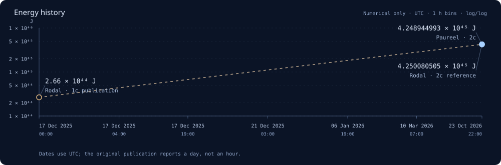

# Ad Astra



Collaborative research into lower-energy warp geometries, with a reproducible
evaluator, scoped Lean proofs, and an interactive 3D visualization.

The current benchmark uses [Rodal’s geometry](https://arxiv.org/abs/2512.18008v1)
at **2c** with a **10 m cabin radius**. Its energy values are numerical estimates;
there are no formally certified candidates or demonstrated propulsion systems.
The dashed timeline segment connects the original 1c publication to the 2c
benchmark; their different parameters do not establish an improvement.

The separate [compact100 research candidate](research/compact100/README.md)
replays to **1.54482–1.54531 × 10⁴⁵ J**, at least **63.63% below the Rodal 2c
reference**, using a broader family and a redesigned 100 m exterior. The viewer
shows its **1.5448691 × 10⁴⁵ J** numerical estimate as “Paureel · Compact 100 m,”
with the interval in provenance. History arrows switch the actual geometry and
optics together. This is a separate scenario, not a v1 benchmark record.

## Run locally

The viewer needs Node 18+ and includes saved results. No npm install is needed.

```sh
git clone https://github.com/Paureel/ad-astra.git
cd ad-astra
npm run dev
```

Open <http://127.0.0.1:4173>. For numerical research, install Python 3.12 and run:

```sh
make setup
make check
```

Proof changes also require [Lean 4.35.0](formal/README.md) and `make check-formal`.
`npm run build` prepares the static viewer in `dist/`; hosting stays local.

## Contribute

Pick an [issue](https://github.com/Paureel/ad-astra/issues) or a
[backlog task](tasks/backlog.json), work on a branch, and open a pull request.
Research, independent checks, proofs, visualization, and documentation are welcome.
Use [Discussions](https://github.com/Paureel/ad-astra/discussions) for open questions.
The repository is private; contributors need an invitation from the owner.

Read [CONTRIBUTING.md](CONTRIBUTING.md). Agents start with [AGENTS.md](AGENTS.md).
Include exact inputs, actual checks, limitations, and attribution with each change.
Run `npm run data` after updating the history to refresh the app and this timeline.

## Documentation

- [Setup](docs/LOCAL_SETUP.md) · [Agent setup](CODEX_BOOTSTRAP.md)
- [Benchmark and baseline](docs/BASELINE.md) · [Mathematics](docs/MATHEMATICS.md)
- [Validation](docs/VALIDATION.md) · [Formal proof scope](docs/FORMALIZATION.md)
- [Research workflow](docs/RESEARCH_WORKFLOW.md) · [Viewer and history](web/README.md)
- [Sources](SOURCES.json) · [Citation](CITATION.cff)

## License

[Apache 2.0](LICENSE). Original bootstrap and third-party notices are retained
in [NOTICE](NOTICE) and [licenses/](licenses/).
